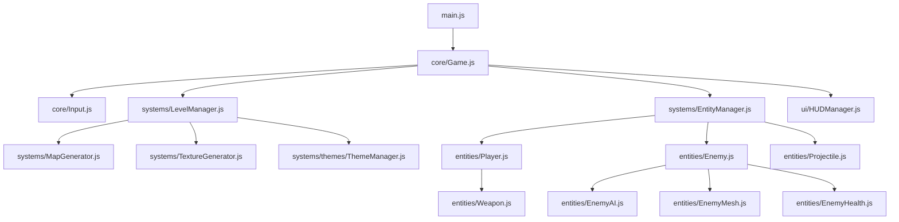

# 🗺️ ARCHITECTURE TECHNIQUE & GUIDE DE DÉVELOPPEMENT APPROFONDI (IA-RogueLike)

Ce document constitue un audit de niveau "Deep Dive" et une fiche de route pour les futurs **LLMs** et **développeurs** travaillant sur la base de code d'**IA-RogueLike**. Il fournit les équations de calcul exactes, les structures de données, la logique algorithmique et les optimisations du système.

---

## 🏛️ 1. ARCHITECTURE DES COMPOSANTS & PARADIGME DU MOTEUR

Le jeu utilise un rendu WebGL via **Three.js** dans un conteneur unique avec une boucle de rendu synchronisée.



### Boucle de Rendu Principale
La boucle est initialisée dans `Game.js` via `renderer.setAnimationLoop(() => this.update())`.
* **Delta Time** : Calculé par `const dt = this.clock.getDelta();`.
* **Pause** : Si `this.isPaused` est vrai (menu actif), le moteur appelle `renderer.render(this.scene, this.camera)` mais court-circuite toutes les mises à jour logiques.

---

## 📊 2. STRUCTURES DE DONNÉES & SCHÉMAS MATHÉMATIQUES

### A. Équilibrage des Statistiques d'Arme (`Weapon.js`)
L'arme magique (`Weapon`) possède les statistiques internes suivantes (calculées dans `recalculateStats()`) :

| Variable | Stat Upgrade | Formule Mathématique / Équation de Calcul |
| :--- | :--- | :--- |
| `damage` | `damage` | `this.baseDamage * (1 + level * 0.18) * pactDamageMultiplier / bulletCount` |
| `fireRate` | `fireRate` | `Math.max(0.05, this.baseFireRate * Math.pow(0.94, level)) / pactFireRateMultiplier` (divisé par 2 sous Berserk) |
| `maxAmmo` | `ammo` | `Math.floor(this.baseMaxAmmo * (1 + level * 0.25))` |
| `reloadTime`| `reload` | `Math.max(0.1, this.baseReloadTime * Math.pow(0.88, level))` |
| `range` | `range` | `this.baseRange * (1 + level * 0.20)` |
| `projectileSpeed` | `projectileSpeed` | `this.baseProjectileSpeed * (1 + level * 0.06) * pactProjectileSpeedMultiplier` |
| `bulletCount` | `bulletCount` | `1 + level` (nombre de projectiles tirés simultanément en éventail) |
| `arc` | — | `this.bulletCount * 2` (angle d'écartement en degrés du tir multiple) |
| `piercing` | `piercing` | `level` (nombre de traversées d'ennemis autorisées par projectile) |
| `critChance` | `critChance` | `this.baseCritChance + level * 0.10` (pourcentage de 0 à 100%) |
| `critDamage` | `critDamage` | `this.baseCritDamage + level * 0.20` (multiplicateur de dégâts bruts) |
| `knockback` | `knockback` | `level` (force de poussée appliquée à la cible) |
| `explosion` | `explosion` | `level * 0.10` (pourcentage de chance de déclencher une explosion AOE à l'impact) |
| `ricochet` | `ricochet` | `level` (nombre maximal de rebonds autorisés sur l'environnement) |

#### Mécanique secrète : Impact Cinétique
Si la vitesse du projectile dépasse la vitesse de base (`projectileSpeed > baseProjectileSpeed`), les dégâts sont augmentés par conversion cinétique :
$$\text{damage}_{\text{final}} = \text{damage} \times \left(1 + \left(\frac{\text{projectileSpeed}}{\text{baseProjectileSpeed}} - 1\right) \times 0.5\right)$$

### B. Statistiques & Modificateurs du Joueur (`Player.js`)
Les formules vivent dans `Player.getStatValue()` / `Weapon.getStatValue()` : `recalculateStats()` **et** le menu d'amélioration les utilisent, ne jamais les dupliquer.

* **Santé Maximale** : `max(25, (100 + stats.maxHealth * 25) * pactHpMultiplier)`.
* **Armure** : `stats.armor * 0.03 + pactArmorBonus`. Réduction directe des dégâts entrants, plafonnée à 80 %.
* **Régénération** : `stats.regen * 0.3` PV/s, plus `healthRegen` (pactes, peut être négatif = drain).
* **Vol de vie** : `stats.vampirism * 0.02 + pactVampirism`. PV rendus = dégâts infligés × vampirism.
* **Vitesse de déplacement** : `PLAYER_SPEED * (1 + stats.speed * 0.08) * pactSpeedMultiplier`, multipliée par `slowMultiplier` au mouvement.
* **Aimant à butin** : `magnetRange = 1.5 + stats.magnet * 0.85` m (2,35 m au niveau 1, 10 m au niveau 10, 0 sans amélioration). Un objet au sol à portée, en vue (pas à travers un mur) et utile (pas de potion quand la vie est pleine) vole vers la poitrine du joueur en accélérant de 3 à 22 m/s (`Pickup.update`), puis est ramassé à 1,5 m.
* **Immolation** : Génère un anneau visuel de 9 m de rayon (`IMMOLATION_RANGE` dans `Player.js`). Inflige `this.stats.immolation * 2.5` dégâts toutes les 0,5 secondes à tous les monstres à moins de 9 mètres.

---

## ⚡ 3. GESTION DES COLLISIONS & PHYSIQUE DES PROJECTILES (`Projectile.js`)

Le projectile se déplace de façon linéaire (par défaut) ou parabolique (si gravité $>0$) :

### Algorithmes de Collisions 3D
1. **Sol** : Si $y \le 0.05$ (hauteur du sol) :
   * Si `ricochet > 0` : `direction.y *= -1`, `ricochet--`, `damage *= 1.25`, et recalcule la position avec $y = 0.06$ pour éviter le blocage.
   * Sinon : Destruction du projectile.
2. **Murs du Donjon** : `firstWallHit()` (`Projectile.js`) parcourt les cases de la grille traversées par le trajet de la frame (algorithme DDA). Il ne teste un mur qu'en entrant dans une nouvelle case, ce qui donne le point d'impact exact et la face touchée, sans traverser un coin à haute vitesse. La première frame part 0,5 m en arrière (le tireur), pour attraper un mur à bout portant.
   * Si `ricochet > 0` : réflexion miroir sur la face (`_reflect`, dégâts ×1,25, portée remise à zéro), puis le projectile parcourt le reste de son pas dans la nouvelle direction. Jusqu'à 3 rebonds par frame dans un coin.
   * Chaque ricochet d'un tir du joueur passe par `_onRicochet()` : si un ennemi en vue est à moins de 15 m dans un cône de 25° autour du rebond, le tir est redirigé vers lui (`RICOCHET_ASSIST_COS`, mettre 0° pour désactiver). Il y a aussi un son spatialisé « ricochet » et une étincelle.
   * Sinon le projectile meurt au point d'impact (étincelle pour les tirs du joueur).
3. **Îles Célestes Flottantes et ponts** : solides. `LevelManager.createSkyIslands()` fusionne leurs pièces en un mesh par matériau pour l'affichage, et enregistre la forme exacte de chaque pièce (boîte orientée, cylindre ou cône) dans `levelManager.skyColliders` (`SkyColliders.js`, grille spatiale de 8 m, environ 150 ns par test). Un projectile qui y entre rebondit selon la normale de la face touchée (`Projectile._reflect`) ou meurt sans ricochet. Le joueur est repoussé hors des îles, peut tenir debout dessus et s'y cogne la tête (`Player._pushOutOfSky`). Les ennemis, guidés par la grille, les ignorent.

---

## 🤖 4. COMPORTEMENT DE L'IA & PATHFINDING (`Pathfinder.js` & `EnemyAI.js`)

### Algorithme A* et optimisation de mémoire
Un seul `Pathfinder` est partagé par tous les ennemis (`levelManager.pathfinder`, l'A* étant synchrone). Les cellules sont indexées par entier (`z * width + x`) et l'état de recherche tient dans des tableaux typés réutilisés, invalidés par un « stamp » par recherche (aucun `clear()`, aucune clé string). Les hauteurs de cellule sont précalculées à chaque nouveau niveau.

```javascript
// Pathfinder.js : Utilisation d'un Min-Heap binaire pour trier l'Open Set en O(log N)
class MinHeap {
    // bubbleUp et sinkDown garantissent que le nœud de f(n) minimal est toujours à l'index 0
}
```

* **Heuristique** : Distance Octile pour autoriser les mouvements sur 8 directions :
  $$H(a, b) = (dx + dz) + (\sqrt{2} - 2) \times \min(dx, dz)$$
* **Lissage de Chemin (Path Smoothing)** : 
  Pour éviter les déplacements brusques en grille, le pathfinder trace un segment de visibilité directe (Line of Sight) depuis le monstre vers chaque étape du chemin. Si aucune paroi n'obstrue la vue (test d'échantillonnage de rayons), les nœuds intermédiaires sont sautés (`_smoothPath`), permettant aux sentinelles de couper les virages naturellement.
* **Séparation (Flocking)** : Les monstres appliquent une force répulsive réciproque :
  $$\vec{F}_{\text{separation}} = \sum_{i=1}^{n} \frac{\vec{P}_{\text{moi}} - \vec{P}_{i}}{\text{distance}(\vec{P}_{\text{moi}}, \vec{P}_{i})}$$
  Cette force est injectée dans le vecteur de mouvement final pour empêcher les ennemis de se superposer en un point unique.

---

## 🎨 5. VISUEL : TEXTURES, LUMIÈRE, PALETTE

Tout le visuel suit **[ART_DIRECTION.md](ART_DIRECTION.md)** : palette sémantique (`src/core/Palette.js` et `src/ui/hud.css`), biomes, textures procédurales seedées (`TextureGenerator.js`), éclairage physique calibré (thèmes et `Game._applyThemeLighting`), entités et effets, budget de performance. Le lire avant toute modification visuelle, puis lancer `npm run preview:visuals` (après `npm i --no-save canvas`).

---

## ⚠️ 6. THÈMES HORS DIRECTION ARTISTIQUE

`BunkerTheme.js`, `IndustrialTheme.js` et `LabTheme.js` (science-fiction) ne sont pas enregistrés dans `ThemeManager`. Ils n'ont ni `biome` ni `lighting`, et leurs textures (panneaux, circuits, sol métallique) ont été supprimées. Ne pas les brancher tels quels : un thème doit suivre la recette « Ajouter un biome » d'ART_DIRECTION.md.

---

## 🎮 7. LOGIQUE D'ATTAQUE DU BOSS SENTINEL (`BossSentinel.js`)

Le Boss Sentinel possède 4 mécaniques d'attaque distinctes fonctionnant sur des timers et des cooldowns indépendants :
1. **Laser Sweep (Balayage) - Cooldown 1.5s** : Déclenche une nova complète projetant 120 sphères de plasma de $0.2$m à $35$ m/s sur un angle radial de $360^\circ$ centré sur l'altitude du joueur.
2. **Homing Missiles (Missiles Guidés) - Cooldown 6.0s** : Tire des projectiles qui traquent continuellement le joueur en réalignant leur vecteur directionnel par interpolation linéaire (`lerp`) à chaque frame.
3. **Spiral Attack (Attaque en Hélice) - Cooldown 15.0s** : Force le boss dans un état de blocage rotatif pendant 4 secondes où il tire des projectiles continus en spirale double.
4. **Summon (Vassaux) - Cooldown 20.0s** : Fait apparaître des `MagicalSentinel` volantes pour détourner le feu du joueur.

---

## 🧭 8. CONVENTIONS DU CODE (à respecter)

* **Projectiles** : `new Projectile(position, direction, speed, damage, levelManager, { sourceName, sourceId, piercing, ... })`. `sourceId === -1` = tir du joueur.
* **Entités posées sur la grille** (pièges, autel, boutique, fontaine, sentinelles) : `(gridX, gridZ, levelManager, checkY)`, où `checkY` choisit l'étage (`0`, `WALL_HEIGHT`, `2 * WALL_HEIGHT`). La position vient de `levelManager.floorPositionAt()`.
* **Collisions** : `levelManager.resolveCircleCollision(pos, radius, checkY)` et `getCollisionCheckY(floorY, feetY)` servent au joueur comme aux ennemis. Le recul (projectile, mêlée, onde de choc) passe par `enemy.ai.knockback(dirX, dirZ, dist)`.
* **Interaction joueur** : `player.isNear(pos, radius)` vérifie aussi l'étage ; `input.consumeKey('KeyE')` pour une touche à usage unique.
* **HUD** : les composants sont appelés à chaque frame et ne touchent le DOM que si la valeur affichée change. Ne jamais réécrire un `innerHTML` sans ce garde-fou.
* **Ressources GPU** : géométries et matériaux partagés au niveau du module pour les entités nombreuses ; `LevelManager._disposeLevel()` libère tout le niveau précédent ; une entité avec des ressources propres expose `dispose()` (appelé par `EntityManager`).
* **UI** : jetons de couleur et typographie dans `src/ui/hud.css` (`--ember` vie/danger, `--aether` mana/bonus, `--gilt` or/rangs, `--hex` chaos/critiques). Les menus sont des `.overlay` affichés avec l'attribut `hidden`.
* **Génération de niveau** : trois phases dans `MapGenerator.generate()` : structure (les supports des étages supérieurs évitent les cases `reserved`), réparations (tunnels, `_settleUpperFloors`, rampes), puis peuplement (`_populate`) sur les grilles finales. Une entité n'est posée que sur une case où elle tient debout sur son étage **et** que le joueur peut atteindre. Ne jamais placer d'entité avant la fin des phases de structure.
* **Carte de hauteurs** : chaque case a un seul sommet praticable, donné par `cellTopHeight()` (exportée par `MapGenerator.js`, utilisée aussi par `Pathfinder`).
* **Vérification sans navigateur** : `npm run check:levels` génère 300 niveaux seedés et vérifie les invariants (rien dans un mur, tout atteignable, rien ne flotte, rez-de-chaussée connexe). À lancer après toute modification de la génération. Ne pas lancer de navigateur headless sur la machine de dev (RAM limitée).
