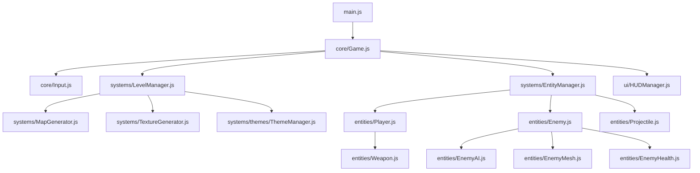

# 🗺️ ARCHITECTURE TECHNIQUE & GUIDE DE DÉVELOPPEMENT APPROFONDI (IA-RogueLike)

Ce document constitue un audit de niveau "Deep Dive" et une fiche de route pour les futurs **LLMs** et **développeurs** travaillant sur la base de code d'**IA-RogueLike**. Il fournit les équations de calcul exactes, les structures de données, la logique algorithmique et les optimisations du système.

---

## 🏛️ 1. ARCHITECTURE DES COMPOSANTS & PARADIGME DU MOTEUR

Le jeu utilise un rendu WebGL via **Three.js** dans un conteneur unique avec une boucle de rendu synchronisée.

### Boucle de Rendu Principale
La boucle est initialisée dans `Game.js` via `renderer.setAnimationLoop(() => this.update())`.
* **Delta Time** : `this.clock.getDelta()` plafonné à `MAX_DT` (0,05 s) : après un gel ou un changement d'onglet, rien ne se téléporte.
* **Pause** : Si `this.isPaused` est vrai (menu actif), toutes les mises à jour logiques sont court-circuitées et la scène n'est plus redessinée (le canvas garde la dernière image), sauf après un redimensionnement (`needsRender`). Perdre le pointeur (Échap) ou cacher l'onglet ouvre l'écran de pause (`Game.pause()`, avec les curseurs de volume des effets et de la musique, bouton « Reprendre » actif après 1 s : Chrome refuse de recapturer la souris juste après Échap). Avec une souris, fermer un menu ne relance la partie qu'une fois le pointeur recapturé (`_resume`, puis l'événement `pointerlockchange`) ; si le navigateur refuse (`pointerlockerror`, par exemple un menu fermé avec Échap, qui ne compte pas comme un geste), l'écran de pause s'affiche. Seul le menu qui se ferme demande le pointeur : le clic global d'`Input` est ignoré pendant une pause.
* **Marche du joueur** (`Player.handleMovement`) : un sol plus haut que les pieds de plus de `STEP_UP` (0,3 m) + la distance parcourue (la pente d'une rampe reste en dessous) arrête le déplacement, avec glissement sur l'axe libre. Le flanc d'une rampe ou le dessus d'un mur à côté d'une rampe demandent donc un saut ; avant, le joueur y était remonté d'un coup (jusqu'à 3 m, environ 60 endroits par niveau), ce qui ressemblait à une téléportation. En l'air, passer au-dessus d'un rebord avec les pieds à moins de `MANTLE` (0,6 m) au-dessus pose le joueur dessus (sinon il survolait un mur de 2 m d'épaisseur encore en montée et retombait derrière). Un saut reste accepté `COYOTE_TIME` (0,12 s) après avoir quitté le sol sans sauter.
* **Entre deux niveaux** : 2 s de compte à rebours (le butin restant vole vers le joueur, `Pickup.pullToPlayer`), puis le menu d'amélioration. Dès que le menu s'affiche, `currentLevel` passe au niveau suivant, qui est construit derrière le menu et ses shaders compilés (`_buildNextLevel`, `renderer.compileAsync`) : le gel de génération est caché par le menu, jamais en jeu. Les cartes tournent 0,8 s ; un clic ou les touches 1 à 9 les révèlent tout de suite, puis choisissent.

---

## 📊 2. STRUCTURES DE DONNÉES & SCHÉMAS MATHÉMATIQUES

### A. Équilibrage des Statistiques d'Arme (`Weapon.js`)
L'arme magique (`Weapon`) possède les statistiques internes suivantes (calculées dans `recalculateStats()`) :

| Variable | Stat Upgrade | Formule Mathématique / Équation de Calcul |
| :--- | :--- | :--- |
| `damage` | `damage` | `this.baseDamage * (1 + level * 0.18) * pactDamageMultiplier / bulletCount` |
| `fireRate` | `fireRate` | `Math.max(0.05, this.baseFireRate * Math.pow(0.94, level)) / pactFireRateMultiplier` (divisé par 2 sous Berserk) |
| `maxAmmo` | `ammo` | `Math.floor(this.baseMaxAmmo * (1 + level * 0.25))` |
| `reloadTime`| `reload` | `Math.max(0.1, this.baseReloadTime * Math.pow(0.88, level))` |
| `range` | `range` | `this.baseRange * (1 + level * 0.20)` |
| `projectileSpeed` | `projectileSpeed` | `this.baseProjectileSpeed * (1 + level * 0.06) * pactProjectileSpeedMultiplier` |
| `bulletCount` | `bulletCount` | `1 + level` (nombre de projectiles tirés simultanément en éventail) |
| `arc` | — | `this.bulletCount * 2` (angle d'écartement en degrés du tir multiple) |
| `piercing` | `piercing` | `level` (nombre de traversées d'ennemis autorisées par projectile) |
| `critChance` | `critChance` | `this.baseCritChance + level * 0.10` (pourcentage de 0 à 100%) |
| `critDamage` | `critDamage` | `this.baseCritDamage + level * 0.20` (multiplicateur de dégâts bruts) |
| `knockback` | `knockback` | `level` (force de poussée appliquée à la cible) |
| `explosion` | `explosion` | `level * 0.10` (pourcentage de chance de déclencher une explosion AOE à l'impact) |
| `ricochet` | `ricochet` | `level` (nombre maximal de rebonds autorisés sur l'environnement) |

#### Mécanique secrète : Impact Cinétique
Si la vitesse du projectile dépasse la vitesse de base (`projectileSpeed > baseProjectileSpeed`), les dégâts sont augmentés par conversion cinétique :
$$\text{damage}_{\text{final}} = \text{damage} \times \left(1 + \left(\frac{\text{projectileSpeed}}{\text{baseProjectileSpeed}} - 1\right) \times 0.5\right)$$

### B. Statistiques & Modificateurs du Joueur (`Player.js`)
Les formules vivent dans `Player.getStatValue()` / `Weapon.getStatValue()` : `recalculateStats()` **et** le menu d'amélioration les utilisent, ne jamais les dupliquer.

* **Santé Maximale** : `max(25, (100 + stats.maxHealth * 25) * pactHpMultiplier)`.
* **Armure** : `stats.armor * 0.03 + pactArmorBonus`. Réduction directe des dégâts entrants, plafonnée à 80 %.
* **Régénération** : `stats.regen * 0.3` PV/s, plus `healthRegen` (pactes, peut être négatif = drain).
* **Vol de vie** : `stats.vampirism * 0.02 + pactVampirism`. PV rendus = dégâts infligés × vampirism.
* **Vitesse de déplacement** : `PLAYER_SPEED * (1 + stats.speed * 0.08) * pactSpeedMultiplier`, multipliée par `slowMultiplier` au mouvement.
* **Pactes d'autel** (`PACTS` dans `Game.js`, 16) : chacun applique des modificateurs `pact*` remis à zéro par `Player.resetPacts()` / `Weapon.resetPacts()` (multiplicateurs à 1, bonus à 0). Un autel en propose 2 au hasard parmi les 16 ; sceller deux fois le même cumule ses effets (sauf l'onde de choc et le plafond du bouclier, qui ne s'additionnent pas). Viser un gain qui vaut à peu près son coût : sang +40 % dégâts / −25 % vie, colosse l'inverse, les autres entre +10 et +25 % sur un axe pour un prix comparable. Mécaniques propres : sauts d'éclair `pactChain` (orage : après un coup, le tir repart vers l'ennemi visible le plus proche à 10 m, pas encore touché, `Projectile.chainToNext`), onde de choc tous les `pactShockwaveKills` tués (`Player.update`), bouclier qui remonte à `pactShieldCap` après 4 s sans dégâts, aura `pactImmolation` ajoutée à l'immolation, `pactJumpMultiplier` sur l'impulsion du saut (hauteur × carré), or et potions ramassés × `pactGoldMultiplier` / `pactPotionMultiplier` (`Pickup.collect`).
* **Aimant à butin** : les objets sont ramassés à 2 m des pieds du joueur (`PICKUP_RANGE` dans `Player.js`) ; `magnetRange = PICKUP_RANGE + stats.magnet * 1.3` m (2 m sans amélioration, 3,3 m au niveau 1, 15 m au niveau 10). Au-delà de 2 m, un objet au sol à portée, en vue (pas à travers un mur) et utile (pas de potion quand la vie est pleine) vole vers la poitrine du joueur en accélérant de 3 à 22 m/s (`Pickup.update`), puis est ramassé.
* **Immolation** : Génère un anneau visuel de 9 m de rayon (`IMMOLATION_RANGE` dans `Player.js`). Inflige `this.stats.immolation * 2.5` dégâts toutes les 0,5 secondes à tous les monstres à moins de 9 mètres.

---

## ⚡ 3. GESTION DES COLLISIONS & PHYSIQUE DES PROJECTILES (`Projectile.js`)

Le projectile se déplace de façon linéaire (par défaut) ou parabolique (si gravité $>0$) :

### Algorithmes de Collisions 3D
1. **Sol** : Si $y \le 0.05$ (hauteur du sol) :
   * Si `ricochet > 0` : `direction.y *= -1`, `ricochet--`, `damage *= 1.25`, et recalcule la position avec $y = 0.06$ pour éviter le blocage.
   * Sinon : Destruction du projectile.
2. **Murs du Donjon** : `firstWallHit()` (`Projectile.js`) parcourt les cases de la grille traversées par le trajet de la frame (algorithme DDA). Il ne teste un mur qu'en entrant dans une nouvelle case, ce qui donne le point d'impact exact et la face touchée, sans traverser un coin à haute vitesse. La première frame part 0,5 m en arrière (le tireur), pour attraper un mur à bout portant.
   * Si `ricochet > 0` : réflexion miroir sur la face (`_reflect`, dégâts ×1,25, portée remise à zéro), puis le projectile parcourt le reste de son pas dans la nouvelle direction. Jusqu'à 3 rebonds par frame dans un coin.
   * Chaque ricochet d'un tir du joueur passe par `_onRicochet()` : si un ennemi en vue est à moins de 15 m dans un cône de 25° autour du rebond, le tir est redirigé vers lui (`RICOCHET_ASSIST_COS`, mettre 0° pour désactiver). Il y a aussi un son spatialisé « ricochet » et une étincelle.
   * Sinon le projectile meurt au point d'impact (étincelle pour les tirs du joueur).
3. **Îles Célestes Flottantes et ponts** : solides. `LevelManager.createSkyIslands()` fusionne leurs pièces en un mesh par matériau pour l'affichage, et enregistre la forme exacte de chaque pièce (boîte orientée, cylindre ou cône) dans `levelManager.skyColliders` (`SkyColliders.js`, grille spatiale de 8 m, environ 150 ns par test). Un projectile qui y entre rebondit selon la normale de la face touchée (`Projectile._reflect`) ou meurt sans ricochet. Le joueur est repoussé hors des îles, peut tenir debout dessus et s'y cogne la tête (`Player._pushOutOfSky`). Les ennemis, guidés par la grille, les ignorent.

---

## 🤖 4. COMPORTEMENT DE L'IA & PATHFINDING (`Pathfinder.js` & `EnemyAI.js`)

### Le terrain vu par les ennemis
La carte est une **carte de hauteurs** : un seul sommet praticable par case (`cellTopHeight`). Entre deux cases voisines **orthogonales**, un déplacement est :
* une **marche** si l'écart de hauteur est inférieur à `STEP_HEIGHT` (2 m) : sols, rampes, dessus des murs ;
* un **saut** jusqu'à `JUMP_UP` (3,1 m) plus haut, ou une **chute** jusqu'à `MAX_DROP` (6,1 m) plus bas ;
* impossible au-delà.

Une **diagonale** n'est permise qu'entre quatre cases toutes à moins de 2 m les unes des autres : jamais à travers le coin d'un mur ou d'un vide. Les sauts ne se font qu'en ligne droite.

### A* (`Pathfinder.findPath`)
Un seul `Pathfinder` est partagé par tous les ennemis (`levelManager.pathfinder`), avec des tableaux typés réutilisés (un « stamp » par recherche) et un tas binaire.
* **Coûts** : 1 par pas droit, √2 en diagonale, +3 pour un saut vers le haut et +1 pour une chute. Les ennemis préfèrent les rampes quand le détour est court.
* **Heuristique** : distance octile `max(dx, dz) + (√2 − 1) × min(dx, dz)`. Elle est admissible et cohérente avec ces coûts, donc les chemins sont optimaux et ne changent pas d'un recalcul à l'autre (c'est ce qui causait les allers-retours).
* `avoid` (optionnel) : des cases qui coûtent +4 à traverser. Un ennemi coincé l'utilise pour contourner la foule.
* **Résultat** : des points de passage `{ x, z, jump }`. Le chemin est découpé en tronçons de marche reliés par des sauts. Chaque tronçon est tendu (« string pulling ») avec `canWalkStraight`, qui vérifie qu'un corps de 0,9 m de rayon passe sans frôler un mur ni un bord de vide. Il n'y a **plus de raccourci en ligne de vue** : l'ancien ignorait les vides et faisait tomber les ennemis en boucle.
* `hasLineOfSight` ne sert qu'au tir et à la vue (gardiens, aimant).

### Comportement (`EnemyAI`)
* **Suivi** : point de passage par point de passage (atteint à 0,4 m). Le saut se déclenche à 2,3 m du centre de la case d'arrivée, puis l'ennemi reste 0,3 s à l'atterrissage. Il recalcule son chemin toutes les 0,8 s (±25 %, pour étaler les calculs), et tout de suite si le joueur s'est éloigné de 4 m du but visé.
* **Arrêt** : seulement s'il **voit** le joueur (ligne de vue testée toutes les 0,2 s), à sa propre distance tirée entre 7 et 11 m, ce qui disperse les groupes en arc. S'il gêne d'autres ennemis derrière lui, il se rapproche pour leur faire de la place, jusqu'à 3,5 m. Il ne vient jamais à moins de 2,2 m du joueur.
* **Foule** : l'écartement entre ennemis ne s'applique que sur le côté, jamais en freinage : ceux de derrière contournent. Ordre des corrections : murs, puis ennemis, puis murs encore (les murs gagnent toujours).
* **Bords** : un ennemi ne descend ni ne monte jamais plus de 2 m en marchant. Il glisse le long du bord, et les chutes sont des sauts voulus. Le recul (tirs, bâton) peut encore le pousser dans le vide.
* **Déblocage** : s'il a bougé de moins de 0,3 m en 1 s alors qu'il poursuit le joueur, il saute un point de passage proche occupé par un autre ennemi, ou recalcule son chemin en évitant la foule.
* **Vérification** : `npm run check:ai` vérifie les règles sur 1 000 chemins, puis simule 60 s sur 30 niveaux, avec le joueur au départ puis n'importe où. Avant cette refonte : 64 % des ennemis atteignaient le joueur, 18 % restaient coincés, 7 % tournaient en boucle et 1 % finissaient dans un mur. Après : 99 %, et 0 % pour les trois autres. À relancer après toute modification de l'IA ou de la génération.

---

## 🎨 5. VISUEL : TEXTURES, LUMIÈRE, PALETTE

Tout le visuel suit **[ART_DIRECTION.md](ART_DIRECTION.md)** : palette sémantique (`src/core/Palette.js` et `src/ui/hud.css`), biomes, textures procédurales seedées (`TextureGenerator.js`), éclairage physique calibré (thèmes et `Game._applyThemeLighting`), entités et effets, budget de performance. Le lire avant toute modification visuelle, puis lancer `npm run preview:visuals` (après `npm i --no-save canvas`).

---

## ⚠️ 6. THÈMES HORS DIRECTION ARTISTIQUE

`BunkerTheme.js`, `IndustrialTheme.js` et `LabTheme.js` (science-fiction) ne sont pas enregistrés dans `ThemeManager`. Ils n'ont ni `biome` ni `lighting`, et leurs textures (panneaux, circuits, sol métallique) ont été supprimées. Ne pas les brancher tels quels : un thème doit suivre la recette « Ajouter un biome » d'ART_DIRECTION.md.

---

## 🎮 7. LE BOSS : SENTINELLE COLOSSALE (`BossSentinel.js`)

Le boss enchaîne **une attaque à la fois**, dans un cycle fixe qu'on peut apprendre : vague, tourbillon, **à terre**, vague, météores, **à terre**, renforts, vague, puis on recommence. Chaque attaque est une **partition** : une liste de temps `[secondes depuis le début de l'attaque, action]`, jouée par `update()`. Le dernier temps clôt l'attaque, repos compris. Pour ajouter une attaque, écrire `_xxxBeats()` et l'ajouter à `CYCLE`.

* **Annonce** (`_announce`, `_countdown`) : l'œil et les runes prennent la couleur de l'attaque pendant `tell` secondes (1,5 s au niveau 10, −0,15 s par palier de 10 niveaux, au moins 0,9 s). Trois tics de plus en plus aigus suivent, le dernier 0,3 s avant le coup, qui tombe donc sur le 4e temps. La première fois, un conseil s'affiche. Ensuite le boss se repose `rest` secondes (2 s, au moins 1 s).
* **Vague d'énergie** : un anneau de 96 orbes, à hauteur de taille (1 m), à 22 m/s. Les trous sont plus étroits que le joueur : il faut sauter. 1 vague au niveau 10, puis une de plus par palier (3 au plus). Dégâts `10 + niveau`.
* **Tourbillon** : 4 s de salves en spirale (8 bras au niveau 10, +2 par palier), à 1 m de haut. Le sens s'inverse toutes les 2 s, annoncé par un tic. Dégâts `7 + niveau`.
* **Pluie de météores** : 30 météores au niveau 10 (+10 par palier, 50 au plus), un toutes les 0,2 s. Un sur trois vise la position du joueur. Le cercle au sol montre la portée réelle (3,5 m) et se remplit jusqu'à l'impact. Dégâts `20 + 1,5 × niveau`.
* **Renforts** : des portails violets s'ouvrent, et les sbires en sortent 2 s plus tard (10 au niveau 10, doublé par palier, 30 au plus).
* **À terre** : le boss s'écrase au sol (son `bossSlam`, message) et reste étourdi 6 s au niveau 10 (−0,5 s par palier, au moins 3,5 s). Il prend alors **dégâts ×2**, et son œil est à portée de l'**épée** (la frappe de `Player.handleSwing` n'a pas besoin de code spécial : le boss est simplement assez bas). Il est solide (`addSolidProp`, hauteur remise à 0 quand il remonte). Il rugit avant de se relever.
* **Sons** : joués sans position, donc à pleine force même de loin. Ce sont des signaux de jeu.
* **Vérification sans navigateur** : `npm run check:boss` fait combattre le vrai boss (niveaux 10, 20, 30) avec les vrais projectiles, le joueur et le gestionnaire d'entités (lots instanciés compris) pendant 90 s simulées ; il échoue sur toute exception ou si une des 5 attaques n'est jamais lancée. À lancer après toute modification du boss, des projectiles ou du rendu en lots. (Le rythme du compte à rebours, l'esquive par le saut et la frappe à l'épée à terre ne sont pas vérifiés par ce script.)

---

## 🧭 8. CONVENTIONS DU CODE (à respecter)

* **Projectiles** : `new Projectile(position, direction, speed, damage, levelManager, { sourceName, sourceId, piercing, ... })`. `sourceId === -1` = tir du joueur.
* **Entités posées sur la grille** (pièges, autel, boutique, fontaine, sentinelles) : `(gridX, gridZ, levelManager, checkY)`, où `checkY` choisit l'étage (`0`, `WALL_HEIGHT`, `2 * WALL_HEIGHT`). La position vient de `levelManager.floorPositionAt()`.
* **Deux armes** : `player.weapon` est le bâton (`Weapon.js`), `player.sword` l'épée (`Sword.js`, modèle `SwordMesh.js`), une seule en main (`player.activeWeapon`, `Player.handleWeapons`). Chaque amélioration a une `source` (`weapon`, `sword`, `player` : qui tient le niveau) et un `for` (`staff`, `sword`, `both`, `general` : ce qu'affiche sa carte) ; chaque pacte un `for` et `apply(player, staff, sword)`. Les critiques sont des améliorations du bâton que l'épée lit aussi (`sword.critChance(staff)`), sans les pactes du bâton ; le vol de vie du joueur vaut pour les deux. Tout tir ennemi qui touche le joueur passe par `player.takeShot(projectile)` (garde, parade, renvoi avec `projectile.reflect()`) : ne jamais appeler `takeDamage` directement depuis un projectile. La furie berserk (coffre, 10 s) passe par `Player._setFury` : bâton sans dépense de mana et cadence ×2 ; épée deux fois plus rapide et +75 % de vol de vie sur ses seuls coups. `npm run check:sword` vérifie tout cela.
* **Collisions** : `levelManager.resolveCircleCollision(pos, radius, checkY)` et `getCollisionCheckY(floorY, feetY)` servent au joueur comme aux ennemis. Le recul (projectile, mêlée, onde de choc) passe par `enemy.ai.knockback(dirX, dirZ, dist)`.
* **Interaction joueur** : `player.isNear(pos, radius)` vérifie aussi l'étage ; `input.consumeKey('KeyE')` pour une touche à usage unique.
* **HUD** : les composants sont appelés à chaque frame et ne touchent le DOM que si la valeur affichée change. Ne jamais réécrire un `innerHTML` sans ce garde-fou.
* **Rendu en lots** : une pièce que beaucoup d'entités affichent (yeux et bulles des ennemis, barres de vie, projectiles et leurs halos) n'a pas de mesh par entité. L'entité expose `draw(entityManager, camera)` et y ajoute sa matrice : `entityManager.batch(geometry, material, colored).add(matrix, color)`, une `InstancedMesh` par couple géométrie + matériau, un seul appel de dessin pour toutes les copies. Créer d'avance, dans le constructeur d'`EntityManager`, les lots connus : un lot né en pleine partie compile son shader à ce moment-là. Les pièces fixes d'un même objet qui bougent ensemble avec le même matériau sont fusionnées en une géométrie (`mergeGeometries` : pointes des pièges, anneau du gardien). Au niveau 25, ça ramène les appels de dessin d'environ 430 à 150 en moyenne.
* **Ressources GPU** : géométries et matériaux partagés au niveau du module pour les entités nombreuses ; `LevelManager._disposeLevel()` libère tout le niveau précédent ; une entité avec des ressources propres expose `dispose()` (appelé par `EntityManager`).
* **UI** : jetons de couleur et typographie dans `src/ui/hud.css` (`--ember` vie/danger, `--aether` mana/bonus, `--gilt` or/rangs, `--hex` chaos/critiques). Les menus sont des `.overlay` affichés avec l'attribut `hidden`.
* **Génération de niveau** : trois phases dans `MapGenerator.generate()` : structure (les supports des étages supérieurs évitent les cases `reserved`), réparations (tunnels, `_settleUpperFloors`, rampes), puis peuplement (`_populate`) sur les grilles finales. Une entité n'est posée que sur une case où elle tient debout sur son étage **et** que le joueur peut atteindre. Ne jamais placer d'entité avant la fin des phases de structure.
* **Taille des cartes** : `mapSizeForLevel(level)` (`MapGenerator.js`, seule source, utilisée par le jeu et les scripts de vérification) donne `34 + 1,3 × niveau` cases de 2 m, plafonné à 95 : 35 cases (70 m) au niveau 1. Les arènes de boss gardent `55 + 1,3 × niveau`, la taille pour laquelle ses attaques sont réglées. Sur les petites cartes, plusieurs choses suivent la taille :
  * les pièces font 4 à 7 cases (6 à 13 dès 46 cases, `_roomSizes`) ;
  * les salles spéciales font 7 et 6 cases (11 et 8 dès 33 cases, `_specialRect`) ;
  * aucune salle spéciale n'est prévue à l'étage 2 sous 44 cases, car elle n'y trouve presque jamais de murs assez épais ;
  * les ennemis apparaissent à au moins 40 % de la largeur de la carte du joueur (30 m au plus) ;
  * les îles flottantes gardent la même densité au mètre carré.
* **Salles spéciales** : au plus `maxSpecialRooms(level) = 2 + floor((level - 1) / 10)` par niveau (2 aux niveaux 1 à 10, 3 de 11 à 20, +1 tous les 10 niveaux, aucune sur un niveau de boss). `_planSpecialRooms` en tire d'abord un trésor et un événement, puis l'un ou l'autre, et choisit l'étage : trésor au rez-de-chaussée ou à l'étage 1, événement aussi dans l'unique salle de l'étage 2. Leurs chambres (anneau de murs compris) ne se touchent jamais et ne touchent pas la salle de départ. Le niveau les expose dans **une seule liste** `levelData.specials` : `{ kind: 'treasure' | 'altar' | 'shop' | 'fountain', floor, room, spawn }`. Un même événement n'apparaît pas deux fois dans un niveau tant qu'un autre reste disponible. `LevelManager` en tire la frise des murs et le sceau au sol, `Game._spawnLevelEntities` le contenu.
* **Gardiens** : chaque salle spéciale a **un seul** gardien (`MagicalSentinel`), dessiné deux fois plus grand que ses pièces (`SIZE`, 3,5 m d'envergure), centré 3,4 m au-dessus de la récompense (`reward.guardian`) ; rien dans une récompense ne doit dépasser 2,1 m. Il vise et se fait toucher à son centre (rayon de touche 1,6 m), mais sa ligne de vue part de 2,8 m (`SIGHT_HEIGHT`), sous le haut des murs. Tant qu'il vit, `isSealed(reward, player, radius)` (`Shrine.js`) bloque le coffre, l'autel, l'échoppe et la fontaine et affiche pourquoi. Il a `40 + 8 × niveau` PV et tire un orbe de `(10 + 2 × niveau) / 2` dégâts toutes les `max(0,5 ; 1 − 0,025 × niveau)` s, à 16 m, seulement s'il voit le joueur. Il n'y a plus d'autre tourelle dans le niveau.
* **Mobilier solide** : l'autel, l'échoppe et la fontaine s'enregistrent via `levelManager.addSolidProp(position, radius, height)` ; `resolveCircleCollision` en repousse le joueur et les ennemis. La liste est vidée à chaque niveau.
* **Carte de hauteurs** : chaque case a un seul sommet praticable, donné par `cellTopHeight()` (exportée par `MapGenerator.js`, utilisée aussi par `Pathfinder`).
* **Vérification sans navigateur** : `npm run check:ai` pour l'IA (section 4) ; `npm run check:levels` génère 300 niveaux seedés (niveaux 1 à 59) et vérifie les invariants (rien dans un mur, tout atteignable, rien ne flotte, rez-de-chaussée connexe, nombre et espacement des salles spéciales), puis affiche le nombre moyen de salles spéciales par dizaine de niveaux. À lancer après toute modification de la génération. Ne pas lancer de navigateur headless sur la machine de dev (RAM limitée).
