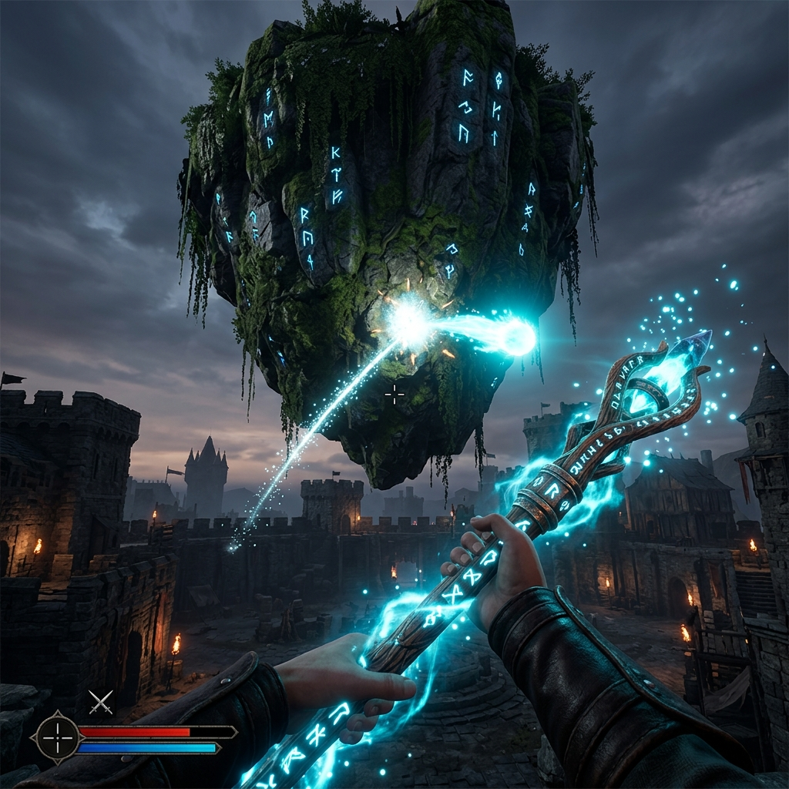
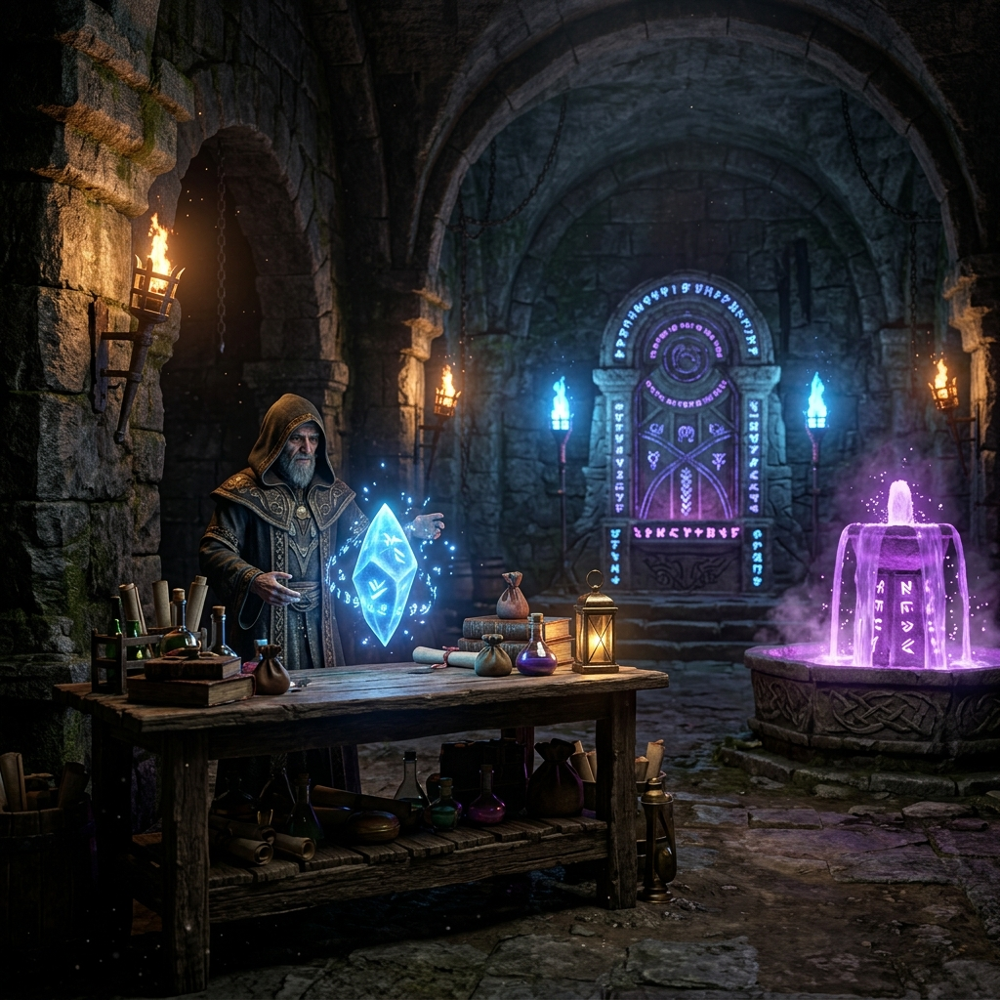

# 🪄 IA-RogueLike : Le Donjon des Ricochets Célestes

[](https://vite.dev/)
[](https://threejs.org/)
[](https://socket.io/)
[]()
[]()

**IA-RogueLike** est un jeu de tir à la première personne (FPS) en 3D procédural développé entièrement dans le navigateur avec **Three.js** et **Vite**. Plongez dans un donjon médiéval-fantastique sombre et mystique où la maîtrise des trajectoires physiques et des rebonds est la clé de votre survie.

Armé de votre sceptre magique entièrement améliorable, progressez de salle en salle, éliminez les sentinelles magiques, esquivez les pièges mortels, défiez des boss colossaux et personnalisez votre arsenal pour descendre le plus profondément possible dans les tréfonds du donjon.



---

## 🎮 Fonctionnalités Majeures



### ⚔️ Gameplay & Combat
* **🎯 Système de Ricochet 3D** : Vos projectiles magiques rebondissent de manière réaliste sur le sol et sur un vaste archipel d'**îles célestes flottantes**. Ces îles, suspendues entre 8 et 40 mètres d'altitude, vous permettent d'atteindre des ennemis cachés derrière des abris par des tirs en cloche indirects.
* **🔫 Arsenal Magique Évolutif** : Votre sceptre possède **13 statistiques améliorables** : Dégâts, Cadence de tir, Munitions, Rechargement, Portée, Vitesse de projectile, Tirs multiples, Perforation, Chance critique, Dégâts critiques, Recul ennemi, Explosions et Ricochets.
* **👁️ IA Ennemie Avancée** : Les ennemis utilisent un **pathfinding A\*** pour vous pourchasser dans le donjon. Ils patrouillent, détectent le joueur, flanquent et attaquent de manière autonome.
* **💥 Critiques & Explosions** : Les tirs critiques déclenchent des effets visuels et sonores distinctifs. Les projectiles explosifs génèrent des zones de dégâts à l'impact.

### 🗺️ Génération Procédurale & Biomes
* **🏰 Génération de Donjon Dynamique** : Chaque niveau est généré algorithmiquement avec des salles interconnectées, des corridors, des îles flottantes et des éléments décoratifs uniques.
* **🌍 6 Biomes Distincts** : Le donjon se transforme visuellement au fil de la descente avec des thèmes complets incluant textures, éclairages et atmosphères propres à chaque biome :
  * 🌿 **Forêt Enchantée** — Végétation mystique, tons verts et ambrés
  * 🏛️ **Cité Médiévale** — Pierres taillées, lanternes et pavés
  * 🪨 **Cavernes Profondes** — Roche volcanique sombre, cristaux lumineux
  * 🔥 **Base Démoniaque** — Lave, braise et atmosphère infernale
  * 🏗️ **Bunker Industriel** — Métal rouillé, tuyauteries, néons
  * 🔬 **Laboratoire Scientifique** — Surfaces high-tech, conteneurs, éclairage froid

### 👾 Ennemis & Boss
* **🤖 Sentinelles Magiques** : Ennemis volants qui utilisent le pathfinding A* pour vous traquer et tirent des projectiles magiques.
* **👑 Sentinelle colossale** : tous les 10 niveaux, un **œil de pierre géant** vous attend dans une arène dédiée. Chaque attaque est annoncée par sa couleur, un son et un compte à rebours :
  * 🌊 **Vague d'énergie** — un anneau d'orbes à hauteur de taille, à sauter au bon moment
  * 🌀 **Tourbillon** — salves en spirale dont le sens s'inverse
  * ☄️ **Pluie de météores** — des cercles au sol qui se remplissent jusqu'à l'impact
  * 👹 **Renforts** — des sbires sortent de portails violets
  * 💥 **À terre** — après ses grosses attaques, le boss s'écrase au sol : frappez-le à l'épée, dégâts ×2

### 💰 Économie & Progression
* **💰 Économie d'Or** : Récupérez l'or laissé par les monstres défaits ou caché dans les **Coffres au Trésor** disséminés dans le donjon.
* **🛒 Marchand Mystique** : Rencontrez le Marchand Magique et échangez votre butin contre des potions de vie, des munitions, des sceaux de bouclier, ou l'une des 3 améliorations qu'il propose à chaque visite (tirées au hasard, 250 or chacune, une seule fois).
* **🩸 Autels de Pactes Anciens** : chaque autel propose 2 pactes permanents tirés au hasard parmi 26 : 10 pour le sceptre, 10 pour l'épée et 6 généraux, chacun étiqueté sur sa carte. Chacun a un prix : vie, dégâts, armure, vitesse, mana, or… Certains changent la façon de jouer : éclairs qui sautent d'ennemi en ennemi, onde de choc tous les 8 ennemis tués, aura de feu, tirs explosifs, épée qui frappe tout autour, projectiles parés renvoyés deux fois plus forts, ondes tranchantes, sauts jusqu'en haut des murs.
* **⚔️ Deux armes** : le **sceptre** tire des projectiles de mana (clic droit : tir chargé de 1,5 s, immobile, qui vide tout l'orbe en un seul gros projectile, puis recharge) ; l'**épée** frappe tous les ennemis dans un arc devant vous (clic droit : garde, qui réduit de 70 % les tirs reçus de face ; dans ses 0,3 premières secondes, elle les renvoie à leur tireur). Une seule arme en main ; changer d'arme annule la recharge du sceptre. Chaque amélioration dit sur sa carte si elle vaut pour le sceptre, l'épée, les deux, ou le personnage.
* **⛲ Fontaines de jouvence** : Boire à une fontaine augmente définitivement vos PV max de 30.

### 🌍 Systèmes Additionnels
* **📦 Objets Ramassables (Pickups)** : Les ennemis et coffres lâchent de l'or, des potions de vie et des munitions.
* **⚠️ Pièges à Pointes Rétractables** : Des pièges géants se déploient depuis le sol et infligent des dégâts massifs si vous marchez dessus.
* **🗺️ Minimap en Temps Réel** : Une minimap 2D se met à jour dynamiquement pour afficher la carte, la position du joueur et celle des ennemis.
* **🎵 Effets Sonores Dynamiques** : Gestion audio complète des tirs, impacts, rechargements, ennemis et pickups via le `SoundManager` (WebAudio API).
* **📱 Contrôles Tactiles** : Support complet des **touches tactiles mobiles** (joystick virtuel et contrôle de la caméra) pour jouer sur smartphone ou tablette.
* **✨ Textes Flottants** : Les dégâts infligés s'affichent en textes animés au-dessus des ennemis (critiques inclus).

---

## ⌨️ Commandes de Jeu

| Action | Clavier | Mobile |
|---|---|---|
| Se déplacer | `Z` `Q` `S` `D` (ou `W` `A` `S` `D`) | Joystick gauche |
| Sauter | `Espace` | Bouton dédié |
| Viser & Attaquer avec l'arme en main | `Souris` / `Clic gauche` | Toucher zone droite / bouton d'attaque |
| Tir chargé (sceptre) / Garde (épée) | `Clic droit` (maintenu) | Bouton dédié |
| Changer d'arme | `A` (`Q` en QWERTY), `Molette`, `1` sceptre, `2` épée | Bouton dédié |
| Recharger le sceptre | `R` | Bouton dédié |
| Interagir (Marchand, Autel, Fontaine, Coffre) | `E` | Bouton `E` |
| Pause / Menu d'amélioration | Automatique (montée de niveau, transition d'étage) | — |

---

## 🚀 Installation et Lancement Rapide

### Prérequis
* [Node.js](https://nodejs.org/) (v18+ recommandé)
* `npm` (inclus avec Node.js)

### Méthode 1 : Lancement Automatique (Recommandé)

Ouvrez votre terminal dans le dossier du projet et lancez :

```bash
./setup.sh
```

Le script vérifiera vos prérequis (Node.js), installera les dépendances nécessaires et démarrera automatiquement le serveur de développement. **Accessible sur le réseau local** grâce au flag `--host`.

### Méthode 2 : Lancement Manuel

1. **Installer les dépendances** :
   ```bash
   npm install
   ```
2. **Lancer le serveur de développement** :
   ```bash
   npm run dev
   ```
3. **Jouer** :
   Ouvrez votre navigateur et accédez à : [http://localhost:5173](http://localhost:5173)

### Build de Production

```bash
npm run build
npm run preview
```

### Statistiques des parties

En production, le jeu enregistre chaque partie de façon anonyme (pas d'adresse IP, pas de compte, un identifiant tiré au hasard par partie) pour guider l'équilibrage : temps par niveau, améliorations proposées et choisies, pactes, boutique, armes utilisées, dégâts subis et causes de mort. Le serveur de développement n'envoie rien.

* `src/systems/RunLog.js` envoie les événements à `POST /api/runs` en fin de niveau, à la mort et quand la page est masquée.
* `server/runs-collector.mjs` (Node, sans dépendance, `127.0.0.1:5190`) les ajoute à `data/runs.jsonl` (hors du dépôt). Il tourne en service utilisateur : `systemctl --user enable --now ~/Documents/IA-RogueLike/server/arcaniste-runs.service`.
* Caddy lui transmet la route, dans le bloc `arcaniste.botscrap.fr`, avant `root` : `reverse_proxy /api/runs 127.0.0.1:5190`.
* `npm run stats` affiche le rapport (`-- --json` pour les agrégats) ; `npm run check:runs` vérifie la chaîne de bout en bout.

---

## 🏗️ Structure du Projet

```text
IA-RogueLike/
├── setup.sh                            # Script d'installation et de lancement automatique
├── index.html                          # Point d'entrée HTML, overlays HUD, boutique, autel
├── OPTIMIZATION_ROADMAP.md             # Feuille de route pour les optimisations techniques
├── public/
│   ├── screenshots/                    # Captures d'écran du jeu
│   └── sounds/                         # Fichiers audio (effets sonores)
└── src/
    ├── main.js                         # Point d'entrée JS — initialisation Three.js et jeu
    ├── style.css                       # Styles globaux de base
    ├── core/
    │   ├── Game.js                     # Moteur principal, boucle de jeu, gestion des états
    │   ├── Constants.js                # Constantes d'équilibrage et de configuration globale
    │   └── Input.js                    # Gestion des inputs clavier/souris et Pointer Lock
    ├── entities/
    │   ├── Player.js                   # Joueur : déplacements, stats, or, dégâts
    │   ├── Weapon.js                   # Arsenal magique — 13 stats améliorables, mécanique de tir
    │   ├── Projectile.js               # Physique des projectiles, gravité, ricochets, homing
    │   ├── Enemy.js                    # Ennemi standard (wrapper)
    │   ├── EnemyAI.js                  # Intelligence artificielle — pathfinding A*, états, attaque
    │   ├── EnemyHealth.js              # Système de santé ennemi (barres de vie 3D)
    │   ├── EnemyMesh.js                # Rendu 3D des ennemis (mesh procédural)
    │   ├── MagicalSentinel.js          # Gardien des salles spéciales — œil flottant qui scelle la récompense
    │   ├── BossSentinel.js             # Boss colossal — 3 patterns d'attaque combinables
    │   ├── FloatingText.js             # Textes flottants animés (dégâts, critiques)
    │   ├── Pickup.js                   # Objets ramassables (or, soin, munitions)
    │   ├── LootChest.js                # Coffres au trésor interactifs
    │   ├── MagicalShop.js              # Marchand Mystique interactif
    │   ├── MagicAltar.js               # Autels de Pactes — bonus/malus permanents
    │   ├── HealingFountain.js          # Fontaines de jouvence (+30 PV max)
    │   └── SpikeTrap.js                # Pièges à pointes rétractables
    ├── systems/
    │   ├── LevelManager.js             # Assemblage 3D, skybox, îles flottantes, éclairage
    │   ├── MapGenerator.js             # Algorithme de génération procédurale de donjon
    │   ├── EntityManager.js            # Gestion du cycle de vie de toutes les entités
    │   ├── TextureGenerator.js         # Génération procédurale de textures (Canvas API)
    │   ├── SoundManager.js             # Sons et effets sonores (WebAudio API)
    │   ├── Minimap.js                  # Minimap 2D en temps réel
    │   ├── Pathfinder.js               # Algorithme A* pour l'IA ennemie
    │   └── themes/
    │       ├── ThemeManager.js             # Orchestration et sélection des thèmes de biome
    │       ├── EnchantedForestTheme.js     # Thème Forêt Enchantée
    │       ├── MedievalCityTheme.js        # Thème Cité Médiévale
    │       ├── DeepCaveTheme.js            # Thème Cavernes Profondes
    │       ├── DemonicBaseTheme.js         # Thème Base Démoniaque
    │       ├── BunkerTheme.js              # Thème Bunker Industriel
    │       ├── IndustrialTheme.js          # Thème Industriel alternatif
    │       └── LabTheme.js                 # Thème Laboratoire Scientifique
    └── ui/
        ├── HUDManager.js               # Gestion de l'affichage tête haute (HUD)
        ├── SVGIcons.js                 # Bibliothèque d'icônes SVG pour l'UI
        ├── TouchControls.js            # Contrôles tactiles mobiles (joystick virtuel)
        ├── hud.css                     # Styles visuels médiévaux-fantastiques du HUD
        └── components/
            ├── AmmoDisplay.js          # Affichage des munitions
            ├── BuffDisplay.js          # Affichage des buffs/debuffs actifs
            ├── GameInfo.js             # Informations de niveau et étage
            ├── HealthBar.js            # Barre de vie du joueur
            └── StatsDisplay.js         # Panneau détaillé des statistiques
```

---

## 🛠️ Stack Technique

| Technologie | Version | Rôle |
|---|---|---|
| [Three.js](https://threejs.org/) | `^0.181.2` | Moteur de rendu 3D WebGL |
| [Vite](https://vite.dev/) | `^7.2.4` | Bundler & serveur de développement |
| [Socket.io-client](https://socket.io/) | `^4.8.1` | Support multijoueur (WIP) |
| Canvas API | Natif | Génération procédurale de textures |
| WebAudio API | Natif | Effets sonores et musique |
| Pointer Lock API | Natif | Contrôle FPS de la souris |

---

## 📈 Feuille de Route

Le fichier [`OPTIMIZATION_ROADMAP.md`](OPTIMIZATION_ROADMAP.md) liste les optimisations techniques prévues pour atteindre un niveau de qualité production :

1. **Zero-Allocation Math** *(Critique)* — Éliminer les `new THREE.Vector3()` dans les boucles `update()`
2. **Object Pooling** *(Haute)* — Réutilisation des projectiles, textes flottants et pickups
3. **Optimisation de la Génération** *(Moyenne)* — `InstancedMesh` pour les ponts et îles flottantes
4. **Partitionnement Spatial** *(Basse)* — Spatial Hash Grid pour les scénarios avec 500+ entités

---

*Développé avec passion pour allier la nostalgie des Rogue-likes rétro et la modernité des rendus 3D web.* 🔮
